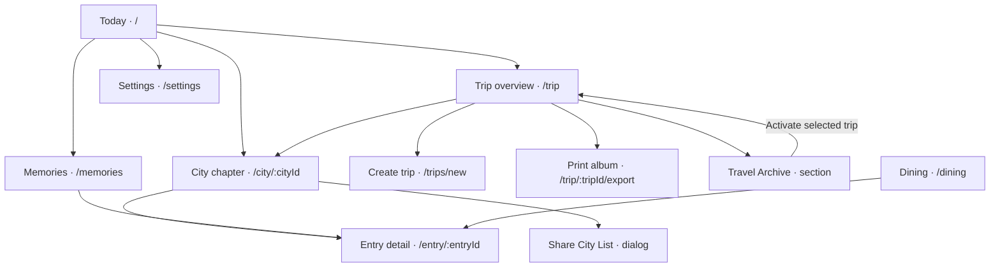
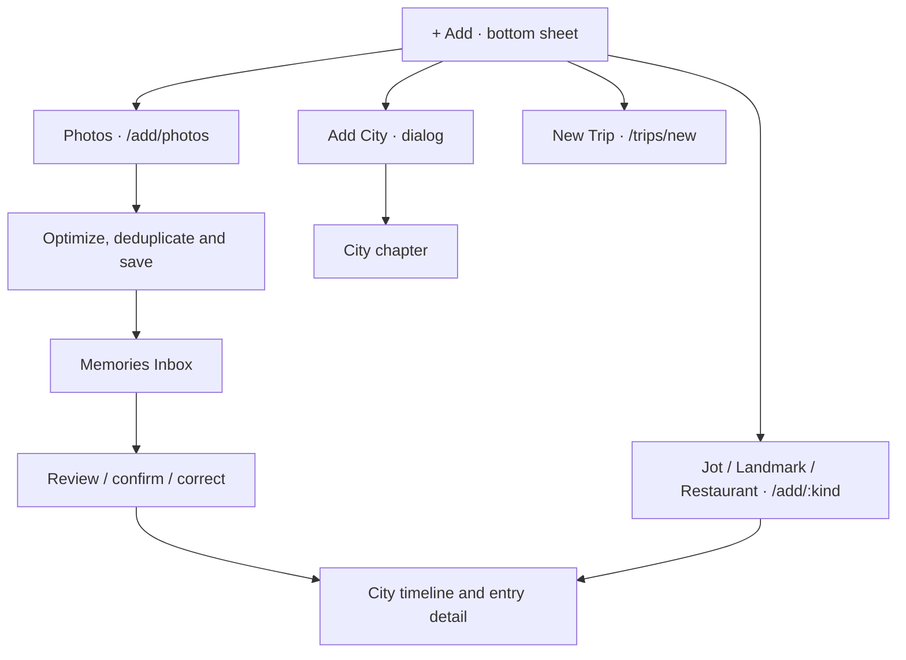
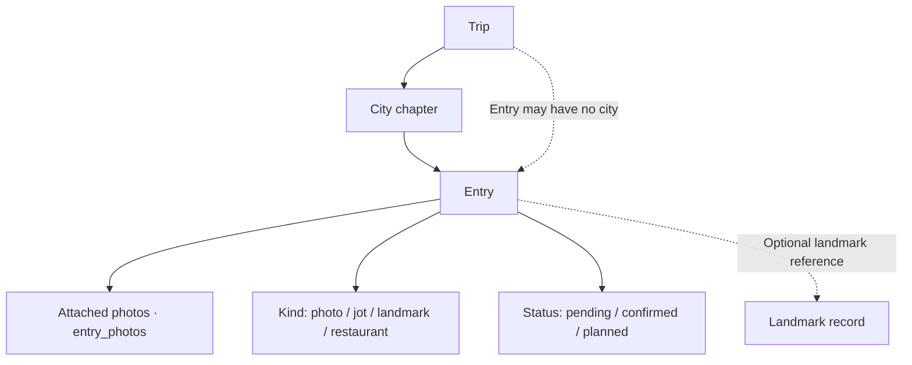
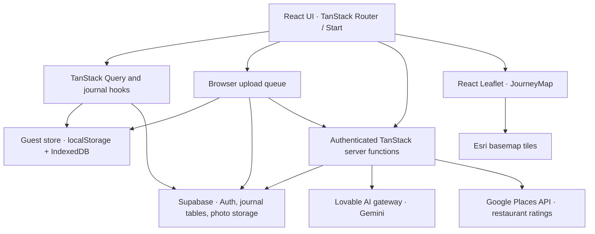

# Touri — Architectural Site Map

Source: [rcraig-2023/photo-trip-journal](https://github.com/rcraig-2023/photo-trip-journal). Reviewed October 30, 2026 against main, source tree `fc568bc007021679d39b54893e7e460186103d90`.

This document maps the implemented information architecture, navigation, photo workflow, and supporting software architecture. Arrows in the site map represent user navigation or containment, not filesystem nesting. Dialogs, filters, and tabs are identified separately from URL routes.

## 1. Main site map

**Persistent bottom navigation:** Today | Trip | + Add | Dining | Memories. Settings is accessed from Today. The shell also exposes account/upgrade status and upload progress. Authentication lives at `/auth`; guest users can browse and create local journal content before signing in.

### Route inventory

| Screen | URL | Content and relationships | Source |
| --- | --- | --- | --- |
| Today | `/` | Current trip/city, recent entries, pending-memory shortcut, start-trip empty state | [index.tsx](../src/routes/index.tsx) |
| Authentication | `/auth` | Account entry; signs in and attempts to sync local guest content to Supabase | [auth.tsx](../src/routes/auth.tsx) |
| Trip overview | `/trip` | Journey map, city chapters, itinerary import, saved ideas, archive switching, export and deletion | [trip.index.tsx](../src/routes/trip.index.tsx) |
| Create trip | `/trips/new` | New trip and destination setup | [trips.new.tsx](../src/routes/trips.new.tsx) |
| City chapter | `/city/:cityId` | Day-by-day timeline; All, Jots, Landmarks, Photos and Restaurants filters; saved ideas; city-list sharing | [city.$cityId.tsx](../src/routes/city.$cityId.tsx) |
| Add photos | `/add/photos` | Multi-photo upload, with optional city context | [add.photos.tsx](../src/routes/add.photos.tsx) |
| Add text/place entry | `/add/:kind` | Shared creation route for jot, landmark or restaurant; optional city context | [add.$kind.tsx](../src/routes/add.$kind.tsx) |
| Memories | `/memories` | Inbox triage and journal browsing, including type filters and photo mosaic | [memories.tsx](../src/routes/memories.tsx) |
| Dining | `/dining` | Restaurant browsing and links to entry detail | [dining.tsx](../src/routes/dining.tsx) |
| Entry detail | `/entry/:entryId` | Shared detail route for memory types, including attached photos and place information | [entry.$entryId.tsx](../src/routes/entry.$entryId.tsx) |
| Settings | `/settings` | Account, membership/quota display, and trip management | [settings.tsx](../src/routes/settings.tsx) |
| Print album | `/trip/:tripId/export` | Dedicated album layout for browser printing/PDF output, without the usual app shell | [trip.$tripId.export.tsx](../src/routes/trip.$tripId.export.tsx) |

`/trip` is an Outlet-only layout; its index supplies the overview. The generated route tree describes the index as `/trip/`, while navigation uses `/trip`.

## 2. Add and capture architecture

The Add sheet is an overlay, not a route. On a city screen, photo and entry creation receive the current city as search context. Add City and New Trip may display an upgrade dialog when account limits apply.

Uploaded photos are saved before recognition finishes. Authenticated uploads create pending entries; AI recognition runs afterward when eligible. The inbox supports individual and bulk confirmation, as well as correction, retry, and deletion. Recognition failure does not itself fail a completed photo upload.

Guest photos are stored locally and skip cloud AI recognition. Signing in triggers a migration attempt for guest trips, cities, entries, and photo blobs.

Sources: [AppShell](../src/components/AppShell.tsx), [upload queue](../src/lib/uploadQueue.ts), [guest store](../src/lib/guestStore.ts), [inbox](../src/routes/memories.tsx).

## 3. Content hierarchy

The dominant browsing hierarchy is **Trip → City → Entry → Photos**. Entries carry both trip and optional city references. Dates, locations, entry kind, and status shape the timeline and filtered views. Planned entries with unknown dates appear as saved ideas rather than dated timeline items.

Photos, Jots, Landmarks, and Restaurants inside a city are **filters on one screen**, not four separate page routes. Photo, landmark, and restaurant detail use the **shared entry-detail route**.

## 4. Supporting system architecture

| Layer | Responsibility | Key source |
| --- | --- | --- |
| Routes and shell | Screen composition, bottom navigation, creation sheet, shared dialogs | `src/routes/`, `src/components/AppShell.tsx` |
| Journal queries | Trips, cities, entries and pending counts; guest/cloud data selection | `src/lib/touri.ts` |
| Guest persistence | Journal metadata in localStorage; photo blobs in IndexedDB | `src/lib/guestStore.ts` |
| Photo pipeline | Optimization, duplicate checks, storage, recognition jobs and guest migration | `src/lib/images.ts`, `src/lib/uploadQueue.ts` |
| Cloud persistence | Supabase journal records and the `memories` storage bucket; signed photo URLs | `src/integrations/supabase/`, `supabase/migrations/` |
| Server integrations | Authenticated landmark recognition/enrichment, itinerary parsing and Google restaurant ratings | `src/lib/ai.functions.ts` |
| Access limits | Guest/free/paid feature availability and quota logic | `src/lib/tiers.ts` |

The current backend uses Supabase directly from browser code for much of its data access, plus TanStack server functions for external AI and ratings calls. A separate native-client API is a product goal in the README; it should not be assumed to exist from this map.

### Where the geographic map fits

The journey map is embedded in **Trip overview**, not a standalone Map route. It receives city coordinates, draws city markers and an ordered connecting line, and loads Esri tiles through React Leaflet. Cities without coordinates are omitted. Panning and zoom controls are disabled in the component, so the map functions as a visual journey overview.

Source: [JourneyMap.tsx](../src/components/JourneyMap.tsx).

## 5. Boundaries and interpretation

- This is a source-based map of implemented screens and code paths, not a runtime verification of the deployed app or external services.
- The README lists aspirational screens separately; the current implementation consolidates timeline filters and detail screens into shared routes.
- Add City, upgrades, itinerary import, and city-list sharing are embedded flows or dialogs, not additional URL pages.
- The web manifest supports mobile installation metadata; this map makes no claim that full offline operation or a service-worker cache is implemented.
- Membership controls are present in the UI and code. A working payment/checkout integration is not established by this review.
- `Require` waits for session loading; it does not redirect guests to authentication. Server AI functions separately require authenticated access.

Route source of truth: [generated route tree](../src/routeTree.gen.ts). Revisit this document when routes or navigation change.
