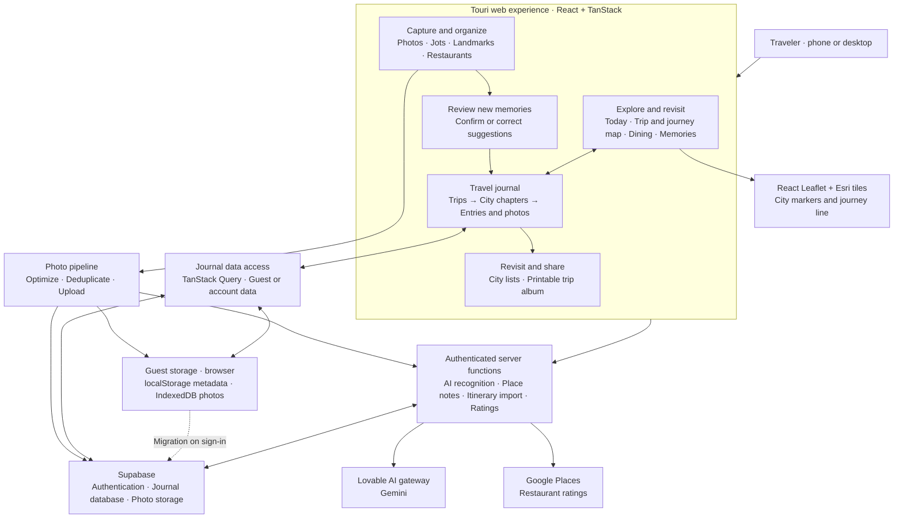

# Touri — Overall Architecture

One high-level view of the photo trip journal, based on the repository implementation reviewed October 30, 2026. Arrows show how the main parts connect; boxes within a group summarize related responsibilities.

**Core idea:** travelers capture memories, review suggestions, and revisit a journal organized by trip and city. Guests save locally; signed-in accounts use Supabase. External AI and ratings requests run through authenticated server functions. The journey map sits inside the Trip overview.

This is a source-based architecture overview, not a verification of deployed services.

Sources: [navigation](../src/components/AppShell.tsx), [journal data](../src/lib/touri.ts), [photo pipeline](../src/lib/uploadQueue.ts), [guest storage](../src/lib/guestStore.ts), [server integrations](../src/lib/ai.functions.ts), [journey map](../src/components/JourneyMap.tsx).
